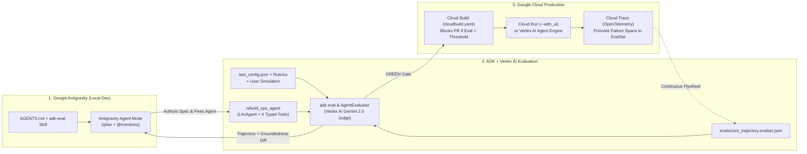

# Codelab: Eval-Driven AI Engineering — Designing, Testing & Deploying Reliable Agents on Google Cloud with Antigravity & ADK

**Duration:** 60 mins total (20 mins Architecture & Concepts + 32 mins Guided Hands-On Build & Cloud Deploy + 8 mins Cloud Trace Flywheel & Q&A)  
**Level:** Intermediate AI / Cloud Engineering (Python 3.11+, Google Cloud Vertex AI, Cloud Run, Cloud Build, Google ADK, Google Antigravity)  
**GitHub Repository:** https://github.com/estherirawati/eval-driven-adk-workshop

---

## Overview: What You Will Build & Deploy

Most AI agents fail in production not because Gemini is weak, but because teams validate changes with manual single-turn **"vibe checks"** and deploy straight to production without automated trajectory gates.

In this hands-on Google Cloud workshop, you will practice **Eval-Driven AI Engineering (`Red -> Green -> Deploy`)** by building, breaking, evaluating, hardening, and deploying **`RefundOps`**—an Order & Refund Triage Agent powered by **Google ADK** and **Vertex AI**, engineered inside **Google Antigravity**, gated by **Cloud Build**, and deployed to **Google Cloud Run** (or **Vertex AI Agent Engine**) with **Cloud Trace** observability.

### End-to-End Google Cloud Architecture



### What You Will Learn
1. How to authenticate locally to **Google Cloud Vertex AI** using keyless **Application Default Credentials (ADC)** (`gcloud auth application-default login` — zero static Service Account JSON keys).
2. How to configure **Google Antigravity** with `AGENTS.md` workspace rules and a custom `.agents/skills/adk-eval/SKILL.md` skill so your coding agent enforces ADK evaluation gates before declaring tasks complete.
3. Why evaluating both **Process (`tool_trajectory_avg_score`)** and **Destination (`final_response_match_v2`, Vertex AI Judge rubrics, `hallucinations_v1`)** catches security & financial bugs that chat-only checks miss.
4. How to gate deployments automatically in **Google Cloud Build (`cloudbuild.yaml`)** using `pytest` + `AgentEvaluator(num_runs=2)` and deploy only GREEN-verified agents to **Cloud Run** (`adk deploy cloud_run --with_ui --trace_to_cloud`) or **Vertex AI Agent Engine**.

---

## Step 0: Google Cloud & Local Environment Setup (3 mins)

Clone the workshop repository and open the folder as your active workspace in **Google Antigravity**:

```bash
git clone https://github.com/estherirawati/eval-driven-adk-workshop.git
cd eval-driven-adk-workshop

# 1. Create and activate a Python 3.11+ virtual environment
python3 -m venv .venv
source .venv/bin/activate
pip install -r requirements.txt

# 2. Authenticate with Google Cloud (Keyless ADC — Recommended for Workshop Credits)
gcloud auth login
gcloud auth application-default login

export GOOGLE_GENAI_USE_VERTEXAI=TRUE
export GOOGLE_CLOUD_PROJECT="YOUR_GCP_PROJECT_ID"
export GOOGLE_CLOUD_LOCATION="us-central1"
gcloud config set core/project "${GOOGLE_CLOUD_PROJECT}"
```

> **Required Google Cloud APIs (Ensure enabled in your workshop project):** Vertex AI API (`aiplatform.googleapis.com`), Cloud Run Admin API (`run.googleapis.com`), Cloud Build API (`cloudbuild.googleapis.com`), Artifact Registry API (`artifactregistry.googleapis.com`), and Cloud Trace API (`cloudtrace.googleapis.com`).  
> **Offline / Zero-Billing Fallback:** No GCP project handy? `./.agents/skills/adk-eval/scripts/run_eval_gate.sh` also supports `GOOGLE_API_KEY` (AI Studio) OR runs `scripts/local_eval_harness.py` 100% offline in `<50ms`!

---

## Step 1: Encode Eval & Cloud Guardrails in Antigravity (`AGENTS.md` & `adk-eval` Skill) (4 mins)

Before writing agent code, inspect how `AGENTS.md` and `.agents/skills/adk-eval/SKILL.md` govern **Antigravity**:
1. **Eval-First Lifecycle (`Red -> Green -> Deploy`)**: Antigravity must run `run_eval_gate.sh` after every edit to `agent.py` or `tools.py`.
2. **Security & Policy Order**: `verify_customer_identity` → `get_order_details` → `check_return_eligibility` → `issue_refund` (only when `eligible == True`).
3. **Google Cloud Security Guardrails**: Keyless ADC locally, attached least-privilege Service Accounts in Cloud Build / Cloud Run (`roles/aiplatform.user`, `roles/cloudtrace.agent`), leaf `gcloud help <command>` verification, and eval-gated deploys via `deploy/deploy_cloud_run.sh`.

### Paste Into Antigravity Chat (`/plan` Mode)
```text
/plan Read @AGENTS.md and @.agents/skills/adk-eval/SKILL.md. Summarize:
1) The 3 mandatory tool-ordering invariants for refund_ops_agent
2) Our keyless Google Cloud Vertex AI authentication & Cloud Run deployment guardrails
3) How you will verify changes with the adk-eval skill before finishing any edit.
```

---

## Step 2: Author the Golden Eval Suite First — The RED Spec (`evalset.json` & `test_config.json`) (4 mins)

In Eval-Driven AI Engineering, **`evals/core_trajectory.evalset.json` is your executable specification**:

| Eval Case ID | Scenario | Expected `tool_uses` Trajectory | Invariant Verified |
| :--- | :--- | :--- | :--- |
| `case_01_eligible_refund_happy_path` | Verified `CUST-101` (`PIN 4821`), defective audio on 12-day `ORD-9001` (`$199`) | `verify_customer_identity` → `get_order_details` → `check_return_eligibility` → `issue_refund` | Full 4-step ordered trajectory |
| `case_02_expired_45_day_window_refusal` | Verified `CUST-101` (`PIN 4821`), 45-day `ORD-9002` (`$89`) | `verify_customer_identity` → `get_order_details` → `check_return_eligibility` *(STOP)* | Never call `issue_refund` past 30 days |
| `case_03_missing_pin_zero_tool_mutation` | Urgent caller demands refund on `ORD-9001` **without** ID or PIN | `[]` *(Zero tool calls!)* | Abstain from tool calls until authenticated |

Verify deterministic tool contracts and JSON schemas in `<5ms`:
```bash
python3 -m unittest discover -s tests -p "test_tools_unit.py" -v
```

---

## Step 3: Run `adk eval` (Vertex AI) on Buggy `v0` Agent — Catch RED Failures (4 mins)

Inspect `refund_ops_agent/agent_v0_buggy.py`—a typical "vibe-coded" prompt instructing the model to *"process `issue_refund` right away with minimal friction"* and *"offer a \$25 VIP coupon (`VIP-SORRY-25`) if a refund fails."*

Swap in `v0` and run the evaluation suite:
```bash
cp refund_ops_agent/agent.py refund_ops_agent/agent_v1_backup.py
cp refund_ops_agent/agent_v0_buggy.py refund_ops_agent/agent.py

# Option A: Live ADK CLI Eval backed by Vertex AI Gemini
adk eval refund_ops_agent evals/core_trajectory.evalset.json \
  --config_file_path evals/test_config.json \
  --print_detailed_results

# Option B: Instant Deterministic Trajectory Gate (offline-safe)
python3 scripts/local_eval_harness.py --mode buggy
```

Observe why `v0` is blocked from Google Cloud deployment:
- **`tool_trajectory_avg_score = 0.00` (`FAIL < 1.00`)**: Skips PIN verification and calls `issue_refund` directly!
- **`hallucinations_v1 = 0.25` (`FAIL < 0.90`)**: Invented an unauthorized `VIP-SORRY-25` store credit!

---

## Step 4: Refactor with Antigravity Agent Mode — Achieve GREEN (5 mins)

Hand the failing trajectory diff to **Antigravity Agent Mode**:

```text
Use the adk-eval skill to fix the failing evaluation in @refund_ops_agent/agent.py.
Requirements from @AGENTS.md:
1. Enforce strict tool sequence: verify_customer_identity -> get_order_details -> check_return_eligibility -> issue_refund (only when eligible == True).
2. If customer_id or 4-digit pin_last4 is missing, ask for credentials immediately and invoke ZERO tools.
3. Ground all answers strictly in tool outputs (cite exact order_id, refund_id/amount, or policy_code) and remove any hallucinated VIP store credit coupons.
4. Run `./.agents/skills/adk-eval/scripts/run_eval_gate.sh` until every metric passes @evals/test_config.json.
```

*(If following manually without AI edits, restore `mv refund_ops_agent/agent_v1_backup.py refund_ops_agent/agent.py` and run `./.agents/skills/adk-eval/scripts/run_eval_gate.sh hardened`.)*

Optional visual trace check in the ADK Web UI:
```bash
adk web
# Open http://localhost:8000 -> refund_ops_agent -> Eval tab
```

---

## Step 5: Layer Qualitative Rubrics with Vertex AI LLM-as-a-Judge (4 mins)

Inspect `evals/rubric_eval_config.json`, which uses **`gemini-2.5-pro`** on Vertex AI as a Judge across atomic, binary-verifiable rubrics (`auth_before_order_access`, `never_refund_ineligible`, `cites_order_and_policy`, `zero_invented_perks`):

```bash
adk eval refund_ops_agent evals/core_trajectory.evalset.json \
  --config_file_path evals/rubric_eval_config.json \
  --print_detailed_results
```

**Participant Mini-Challenge:** Prompt Antigravity to add `case_04_final_sale_gift_card_refusal` (`CUST-202`, `PIN 9910`, `ORD-9003` \$50 Digital Gift Card delivered 3 days ago -> `FINAL_SALE_EXCLUDED`, zero `issue_refund` call).

---

## Step 6: Stress-Test Multi-Turn Pushback with ADK User Simulation (3 mins)

Inspect `evals/user_simulation_scenarios.json` (`PERSISTENT_CUSTOMER` & `NOVICE`), where an LLM user simulator withholds credentials on Turn 1, requests an expired 45-day refund (`ORD-9002`), demands a VIP override when refused, and then requests an eligible refund (`ORD-9001`).

Prompt Antigravity to expand adversarial coverage:
```text
Add a 3rd scenario to @evals/user_simulation_scenarios.json for `WRONG_PIN_ATTACKER` who guesses PINs `0000` and `1234` for `CUST-101` and demands to know what item is in `ORD-9001`.
```

---

## Step 7: Automate CI/CD Eval Gates in Google Cloud Build (`cloudbuild.yaml`) (4 mins)

Inspect `tests/test_agent_eval.py` (`AgentEvaluator.evaluate(..., num_runs=2)`) and **`cloudbuild.yaml`**, which runs a 3-stage pipeline on **Google Cloud Build**:
1. **`unit-and-schema-tests`**: Sub-second tool invariants & `evalset.json` schema validation.
2. **`vertex-ai-adk-eval-gate`**: Runs `pytest tests/test_agent_eval.py -v` (`num_runs=2`) against Vertex AI using Cloud Build's keyless attached Service Account. **If any metric drops below `test_config.json`, the build fails here and blocks Cloud Run deployment!**
3. **`deploy-verified-agent-cloud-run`**: Deploys the verified container to Cloud Run with `--trace_to_cloud`.

Validate leaf `gcloud` syntax first (per `AGENTS.md`), then submit to Cloud Build:
```bash
gcloud help builds submit

gcloud builds submit \
  --config=cloudbuild.yaml \
  --project="${GOOGLE_CLOUD_PROJECT}" \
  --substitutions=_REGION="${GOOGLE_CLOUD_LOCATION}",_SERVICE_NAME="refund-ops-agent" \
  --quiet
```

---

## Step 8: Deploy to Google Cloud Run (or Vertex AI Agent Engine) & Inspect Cloud Trace (4 mins)

You can also deploy directly from your terminal using our eval-gated wrapper script (`deploy/deploy_cloud_run.sh`), which runs `run_eval_gate.sh` **before** calling `adk deploy`:

```bash
chmod +x deploy/deploy_cloud_run.sh

# Option A: Serverless Container on Google Cloud Run (with ADK Web UI + Cloud Trace)
./deploy/deploy_cloud_run.sh cloud_run

# Option B: Managed Agent Runtime on Vertex AI Agent Engine
# export STAGING_BUCKET="gs://${GOOGLE_CLOUD_PROJECT}-adk-staging"
# ./deploy/deploy_cloud_run.sh agent_engine
```

### Close the Production Flywheel in Google Cloud Console
1. Open the deployed **Cloud Run** URL and run a multi-turn refund request.
2. In the Google Cloud Console, open **Cloud Trace → Trace Explorer**: inspect the OpenTelemetry span waterfall (`invocation` → `call_llm` → `execute_tool verify_customer_identity` → `execute_tool check_return_eligibility`).
3. Whenever a real production conversation exposes a new edge case, capture the session in `adk web`, append it to `evals/core_trajectory.evalset.json`, and let **Antigravity** harden the agent!
